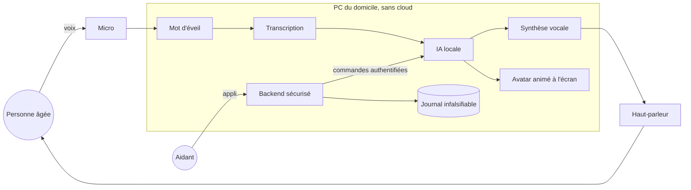

# Cahier des charges — Assistant compagnon sécurisé

> Project Lab ESIEE-IT · Équipe 1B Cybercore · Sujet 2 : Interaction multimodale sécurisée
> Novembre 2026.
> Les éléments entre `[À COMPLÉTER]` ou `[À CHOISIR]` sont à valider par l'équipe.

## 1. Contexte et objectifs

### 1.1 Problématique

Les personnes âgées qui vivent seules s'isolent : moins de conversations, moins de sorties. Les assistants vocaux du marché traitent la voix dans le cloud et ne sont pas pensés pour elles. Leurs aidants manquent de moyens simples pour garder le contact.

### 1.2 Solution

Un assistant compagnon qui dialogue à voix haute grâce à une IA 100 % locale, incarné par un robot simulé (avatar animé à l'écran), avec une application sécurisée pour les aidants.

### 1.3 Objectifs

| N° | Objectif | Critère de réussite |
|---|---|---|
| O1 | Dialoguer à voix haute, sans compétence technique | Mot d'éveil détecté ≥ 90 %, ≥ 90 % de mots bien transcrits, réponse en moins de 5 s |
| O2 | Garder le lien : pousser à sortir, à appeler un proche | 4 testeurs sur 5 se disent encouragés à sortir |
| O3 | Sécuriser : aucune donnée hors de la maison, commandes critiques authentifiées | 0 donnée envoyée sur Internet, 100 % des commandes critiques tracées, 0 faille critique au test d'intrusion |

### 1.4 Hors périmètre

Robot physique, déplacement, manipulation d'objets, reconnaissance de gestes, suivi médical, alerte d'urgence, commercialisation. Détail dans `perimetre_fonctionnel.md`.

---

## 2. Utilisateurs et besoins

| Utilisateur | Besoins | Contraintes à respecter |
|---|---|---|
| **Personne âgée isolée** (utilisateur principal) | Parler simplement, être écoutée, être encouragée à sortir, ne pas oublier ses rappels | Audition et vue parfois réduites, peu à l'aise avec le numérique : tout doit passer par la voix |
| **Aidant** (famille, proche) | Garder le contact, envoyer des messages, régler des rappels, être rassuré | Peu de temps, respect de l'intimité du proche : il ne doit pas pouvoir « espionner » les conversations |

---

## 3. Exigences fonctionnelles

| Réf. | Exigence | Priorité |
|---|---|---|
| F1 | Détecter un mot d'éveil CyberCore | Indispensable |
| F2 | Transcrire la parole en français | Indispensable |
| F3 | Générer une réponse courte (1 à 2 phrases) avec une IA locale, selon une personnalité définie | Indispensable |
| F4 | Répondre à voix haute avec une voix française naturelle | Indispensable |
| F5 | Afficher un avatar animé qui montre son état (veille, écoute, réflexion, parole) | Indispensable |
| F6 | Proposer de sortir ou d'appeler un proche | Indispensable |
| F7 | Permettre à l'aidant d'envoyer un message ou de régler un rappel depuis l'appli | Indispensable |
| F8 | Authentifier toute commande critique | Indispensable |
| F9 | Tracer chaque commande critique dans un journal infalsifiable | Indispensable |
| F10 | Mémoriser le contexte d'une conversation courte | Important |
| F11 | Permettre d'interrompre l'assistant pendant qu'il parle | Souhaitable |
| F12 | Porter l'assistant sur un Raspberry Pi durci | Souhaitable |

**Commandes critiques** (F8, F9) : toute action qui modifie le comportement de l'assistant ou donne accès à des données, par exemple créer ou modifier un rappel, ajouter un contact, consulter le journal, changer un réglage. [À COMPLÉTER : liste définitive]

---

## 4. Exigences de sécurité et de confidentialité

| Réf. | Exigence | Vérification |
|---|---|---|
| S1 | Voix, texte et réponses traités uniquement en local, sans appel à un service cloud | Capture réseau pendant 1 h d'utilisation : 0 flux sortant vers Internet |
| S2 | Authentification de l'aidant dans l'appli (mot de passe robuste + second facteur) | Test d'intrusion |
| S3 | Chaque commande critique est authentifiée (jeton ou signature) avant exécution | Tentative de commande forgée refusée |
| S4 | Journal des commandes critiques infalsifiable (entrées chaînées par empreinte) | Modification manuelle du journal détectée |
| S5 | Échanges entre l'appli et l'assistant chiffrés (TLS) | Analyse du trafic |
| S6 | Aucun secret (clé, mot de passe) dans le code ; stockage protégé | Revue de code, scan des secrets |
| S7 | L'aidant ne peut pas lire les conversations de son proche, seulement les messages et rappels qu'il gère | Test des droits d'accès |
| S8 | Dépendances à jour, sans vulnérabilité critique connue | Scan des dépendances |
| S9 | RGPD : données minimisées, consentement explicite, durée de conservation définie, droit à l'effacement | Revue RGPD |
| S10 | Analyse de risques EBIOS RM et test d'intrusion avant la Commission 4 | Rapports dans le dépôt |

---

## 5. Exigences non fonctionnelles

- **Latence** : moins de 5 s entre la fin de la phrase et le début de la réponse (cible 4 s).
- **Accessibilité** : voix lente et claire, phrases courtes ; appli aidant lisible (grands caractères, contrastes).
- **Robustesse** : démarrage automatique, redémarrage des services en cas de plantage.
- **Maintenabilité** : code Python modulaire, versionné sur GitHub, configuration dans un fichier unique.
- **Licences** : licence de chaque modèle et bibliothèque vérifiée (Apache 2.0, MIT, licences Gemma ou Llama).

---

## 6. Spécifications techniques

### 6.1 Architecture

### 6.2 Briques logicielles

| Fonction | Solution candidate | Alternative |
|---|---|---|
| Mot d'éveil | openWakeWord | Porcupine |
| Transcription | whisper.cpp (modèle base ou small) | faster-whisper, Vosk |
| IA (dialogue) | Qwen3 ou Gemma 3 (quantifié) via llama.cpp ou Ollama | Llama 3.2, Ministral 3B |
| Synthèse vocale | Piper TTS (voix française) | Coqui TTS, espeak-ng |
| Avatar | [À CHOISIR] page web animée (HTML/JS) | Simulateur Reachy Mini |
| Appli aidant | [À CHOISIR] application web (PWA) | Flutter, React Native |
| Backend | [À CHOISIR] FastAPI (Python) | Flask |
| Stockage | SQLite chiffrée | — |
| Orchestration | Script Python asynchrone, services système | — |

### 6.3 Matériel

| Élément | Choix | Coût |
|---|---|---|
| Ordinateur | PC de l'équipe (16 Go de RAM conseillés) | 0 € |
| Audio | Micro USB + haut-parleur | 0 à 30 € |
| Option | Raspberry Pi 5 (8 Go), si portage après la Commission 3 | 110 à 170 € |

### 6.4 Fonctionnement (boucle d'états)

1. **Veille** : écoute du mot d'éveil, avatar au repos.
2. **Écoute** : enregistrement jusqu'à la fin de la phrase, avatar attentif.
3. **Transcription** : conversion de la voix en texte.
4. **Réflexion** : génération de la réponse, avatar « qui réfléchit ».
5. **Parole** : réponse à voix haute, avatar animé avec la voix.
6. **Retour en veille** après un délai sans interaction.

Chaque brique est un module indépendant : on peut changer de modèle d'IA ou d'avatar sans toucher au reste.

---

## 7. Contraintes

- **Équipe** : 4 personnes (binôme Cyber, binôme ILMSI), en alternance.
- **Délai** : 84 h de séances Project Lab, jusqu'à la soutenance finale du 27/04/2027, plus le travail à distance.
- **Budget** : 0 à 30 € (option Raspberry Pi : 110 à 170 €). [À COMPLÉTER : financement]
- **Données** : personnes vulnérables, donc RGPD strict.

---

## 8. Plan de réalisation

| Phase | Contenu | Livrable | Jalon |
|---|---|---|---|
| 0 — Cadrage | Périmètre, organisation, risques | Note de cadrage | Commission 2 — 27/11 |
| 1 — Conception | Comparatif des modèles d'IA en français, architecture, maquettes de l'appli, analyse EBIOS RM | Dossier de conception, démo du dialogue sur PC | Commission 3 — 05/02 |
| 2 — Réalisation | Chaîne vocale complète, avatar, appli aidant, backend, authentification, journal | Assistant fonctionnel | Sprints de 2 semaines |
| 3 — Sécurisation et tests | Test d'intrusion, plan de test, tests avec 5 utilisateurs | Rapports de tests | Commission 4 — 09/04 |
| 4 — Soutenance | Démo, documentation finale | Dossier final | Commission 5 — 23/04, finale — 27/04 |
| Option | Portage sur Raspberry Pi durci | Assistant sur Pi | Après la Commission 3 |

---

## 9. Plan de test et critères de réception

| Test | Méthode | Critère de réussite |
|---|---|---|
| Mot d'éveil | 20 essais à 1 m, en silence puis avec bruit de fond | ≥ 90 % de détections, < 1 faux déclenchement par heure |
| Transcription | 20 phrases courantes en français | ≥ 90 % de mots corrects |
| Latence | Chronométrer 20 échanges | Moyenne < 5 s (cible 4 s) |
| Qualité des réponses | 10 conversations de 5 échanges | Réponses cohérentes, courtes, dans le ton voulu |
| Aucun flux vers Internet | Capture réseau pendant 1 h | 0 connexion sortante |
| Commandes critiques | Commandes légitimes et commandes forgées | 100 % des légitimes tracées, 100 % des forgées refusées |
| Journal | Modification manuelle d'une entrée | Altération détectée |
| Test d'intrusion | Appli, backend, poste | 0 faille critique |
| Tests utilisateurs | 5 seniors et quelques aidants | 4 sur 5 se disent encouragés à sortir |
| Robustesse | Redémarrage à froid et 24 h d'activité | Démarrage automatique, aucun plantage |

---

## 10. Risques

Voir la matrice des risques (`05_Risques`). Principaux risques : projet jugé moins ambitieux sans robot physique, usurpation d'une commande critique, latence de l'IA locale, périmètre trop ambitieux, disponibilités réduites.

## 11. Évolutions possibles

- Portage sur Raspberry Pi durci, puis robot physique si une équipe matériel reprend le projet.
- Reconnaissance de plusieurs voix (plusieurs habitants).
- Intégration domotique (lumières, météo, minuteurs).
- Description de ce que voit une caméra, traitée en local.
