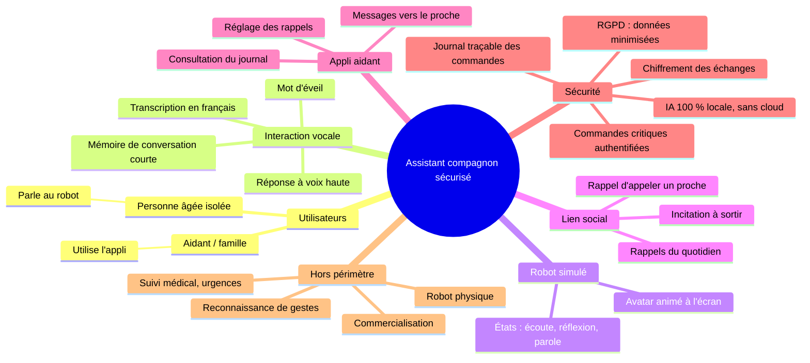

# Périmètre fonctionnel — Équipe 1B Cybercore

> Project Lab ESIEE-IT · Sujet 2 : Interaction multimodale sécurisée
> Ce document définit ce que le projet fait, ce qu'il ne fait pas, et ses limites.

## Le projet en une phrase

Un assistant compagnon qui dialogue à voix haute avec les personnes âgées isolées grâce à une IA 100 % locale, incarné par un robot simulé à l'écran, avec une application sécurisée pour leurs aidants.

## Carte mentale

## Fonctions retenues

| Réf. | Fonction | Utilisateur | Priorité |
|---|---|---|---|
| F1 | Détecter un mot d'éveil (nom du robot) | Personne âgée | Indispensable |
| F2 | Transcrire la parole en français | Personne âgée | Indispensable |
| F3 | Générer une réponse courte avec une IA locale | Personne âgée | Indispensable |
| F4 | Répondre à voix haute (voix française naturelle) | Personne âgée | Indispensable |
| F5 | Afficher un avatar animé qui montre son état (écoute, réflexion, parole) | Personne âgée | Indispensable |
| F6 | Proposer de sortir ou d'appeler un proche | Personne âgée | Indispensable |
| F7 | Envoyer un message ou un rappel depuis l'appli | Aidant | Indispensable |
| F8 | Authentifier toute commande critique (ex. modifier un rappel, accéder au journal) | Aidant | Indispensable |
| F9 | Tracer chaque commande critique dans un journal infalsifiable | Système | Indispensable |
| F10 | Mémoriser le contexte d'une conversation courte | Personne âgée | Important |
| F11 | Interrompre l'assistant pendant qu'il parle | Personne âgée | Souhaitable |
| F12 | Porter l'assistant sur un Raspberry Pi durci | Système | Souhaitable |

## Hors périmètre

| Élément exclu | Raison |
|---|---|
| Robot physique (moteurs, électronique, boîtier) | Départ du binôme RIT, risques matériels  |
| Robot humanoïde, déplacement, manipulation | Irréalisable avant avril  |
| Reconnaissance de gestes | Recentrage demandé en Commission 1 |

## Limites retenues

- Prototype de démonstration, pas un produit fini.
- Environ _ commandes vocales gérées.
- Tests avec environ 5 personnes.
- Tout tourne sur PC, sans cloud ; Raspberry Pi en option.
- Langue : français envisagé.
