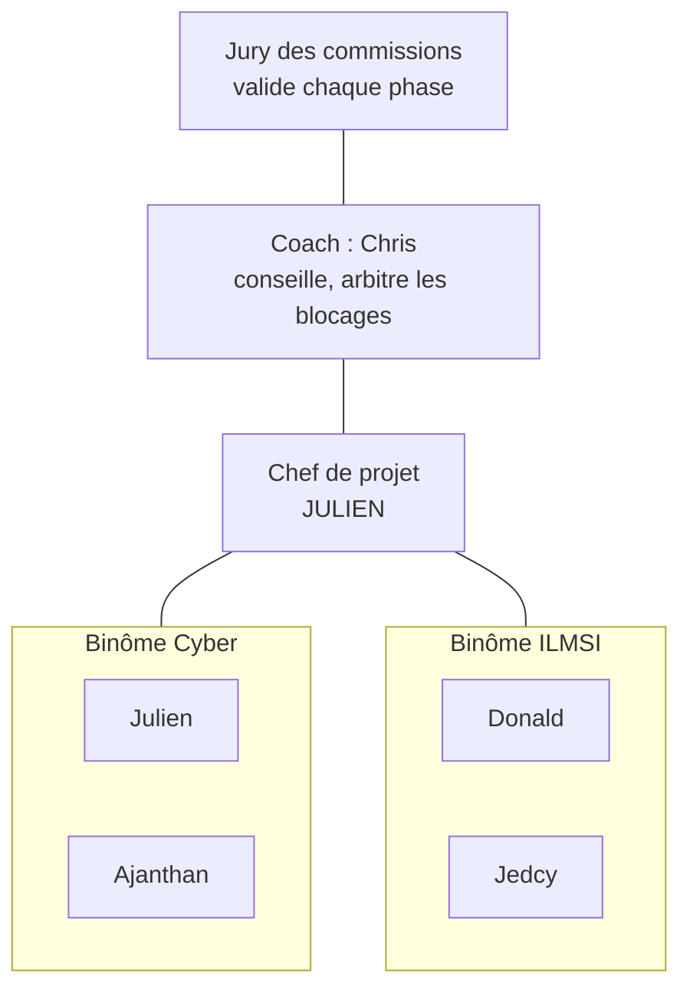

# Rôles et gouvernance — Équipe 1B Cybercore

> Project Lab ESIEE-IT · Sujet 2 : Interaction multimodale sécurisée
> Coach : Chris

## Organigramme

## Composition de l'équipe

L'équipe comptait 6 membres (2 Cyber, 2 ILMSI, 2 RIT). Le binôme RIT (Yoann, Antoine) a quitté l'équipe ; elle compte aujourd'hui 4 membres.

| Membre | Spécialité | Rôle transverse |
|---|---|---|
| Julien | Cybersécurité | Chef de projet |
| Ajanthan | Cybersécurité | Scrum master |
| Donald | ILMSI | Responsable Technique |
| Jedcy | ILMSI | Responsables documentation  |

**Rôles transverses à attribuer :**

- **Chef de projet** : suit l'avancement, prépare les commissions, fait le lien avec le coach.
- **Scrum master** : anime les points d'équipe, tient le Kanban à jour, lève les blocages.
- **Responsable technique** : garde la cohérence de l'architecture (voix, avatar, appli, backend) et pilote l'intégration.
- **Responsable qualité et documentation** : gère le dépôt GitHub et les preuves à jour, organise les tests utilisateurs prochainement
 
## Répartition des responsabilités

| Domaine | Binôme Cyber | Binôme ILMSI |
|---|---|---|
| Analyse de risques EBIOS RM | **Responsable** | Contribue |
| Authentification des commandes critiques | **Responsable** | Intègre dans l'appli |
| Journal infalsifiable des commandes | **Responsable** | Intègre dans le backend |
| Chiffrement, gestion des secrets | **Responsable** | Applique |
| Test d'intrusion | **Responsable** | Corrige |
| Conformité RGPD | **Responsable** | Applique |
| Chaîne vocale (mot d'éveil, transcription, IA, synthèse) | Revue de sécurité | **Responsable** |
| Robot simulé (avatar animé) | — | **Responsable** |
| Appli aidant et backend | Revue de sécurité | **Responsable** |
| Interface adaptée aux seniors, tests utilisateurs | Contribue | **Responsable** |
| Backlog | Contribue | **Responsable** |
| Option : portage sur Raspberry Pi | **Durcissement** | Portage logiciel |

## Fonctionnement collectif

| Rituel | Fréquence | Qui | Trace |
|---|---|---|---|
| Point d'équipe | [À COMPLÉTER : jour, ex. chaque lundi en visio] | Toute l'équipe | Compte rendu dans `04_Organisation/CR/` |
| Point avec le coach | [À COMPLÉTER : fréquence] | Chef de projet + volontaires | Compte rendu |
| Revue de sprint | Toutes les 2 semaines | Toute l'équipe | Mise à jour du Kanban |
| Commissions | Selon le calendrier du Project Lab | Toute l'équipe | Deck et dossier de preuves |

**Travail à distance :** pendant les périodes en entreprise (alternance), l'équipe continue d'avancer à distance. Le suivi passe par GitHub (commits datés) et le Kanban.

## Outils collaboratifs

| Besoin | Outil |
|---|---|
| Code et preuves | GitHub (ce dépôt) |
| Suivi des tâches (Kanban, backlog) | [À COMPLÉTER : ex. Trello, GitHub Projects, Jira] |
| Communication | [À COMPLÉTER : ex. Discord, Teams] |
| Documents partagés | [À COMPLÉTER : ex. Google Drive] |

## Prise de décision

| Type de décision | Qui décide | Comment |
|---|---|---|
| Choix techniques d'un domaine | Le binôme responsable | Le binôme tranche et informe l'équipe |
| Décisions structurantes (périmètre, organisation) | Toute l'équipe | Consensus ; à défaut, vote à la majorité. Notées dans le registre des décisions |
| Blocage ou désaccord persistant | Le coach | L'équipe présente les options, le coach arbitre |
| Validation d'une phase | Le jury | Lors des commissions |

En cas d'égalité lors d'un vote à 4, [À COMPLÉTER : ex. le chef de projet tranche, ou le coach est consulté].
