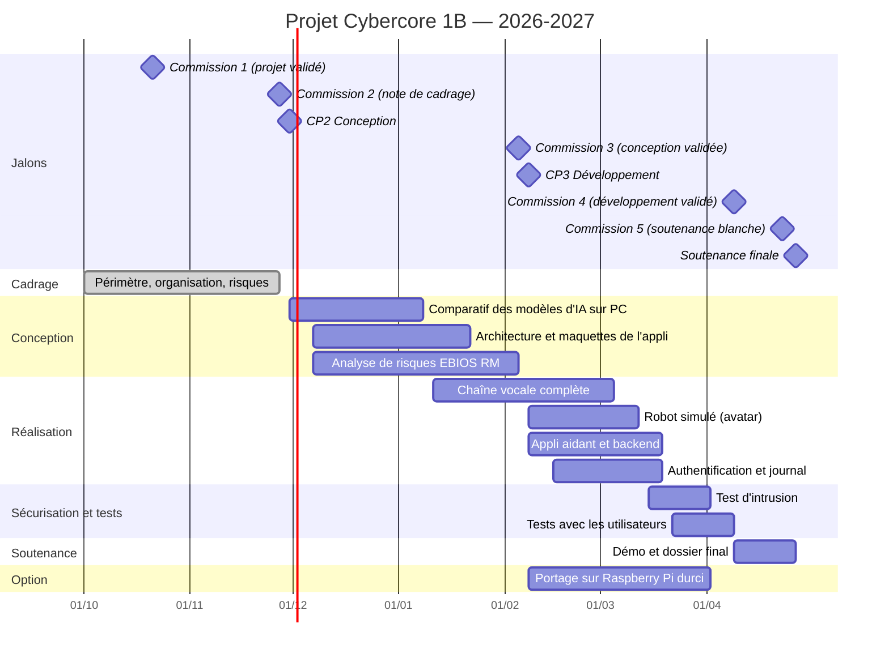

# Planning prévisionnel — Équipe 1B Cybercore

> Project Lab ESIEE-IT · Sujet 2 : Interaction multimodale sécurisée
> Jalons calés sur le calendrier officiel du Project Lab (équipe 1B).

## Diagramme de Gantt

## Jalons et livrables

| Date | Jalon | Livrable | Heures PL |
|---|---|---|---|
| 21/10/2026 | Commission 1 | Projet et axe validés ✓ | — |
| 27/11/2026 | Commission 2 | Note de cadrage (deck + ce dépôt de preuves) | ≈ 13 h |
| 30/11/2026 | CP2 Conception (9h-10h, salle 3.40) | Point d'avancement | — |
| 05/02/2027 | Commission 3 | Dossier de conception, dialogue validé sur PC | ≈ 21 h |
| 08/02/2027 | CP3 Développement (9h-10h, salle 3.40) | Point d'avancement | — |
| 09/04/2027 | Commission 4 | Assistant, appli et sécurité testés | ≈ 46 h |
| 23/04/2027 | Commission 5 | Soutenance blanche, démo | ≈ 2 h |
| 27/04/2027 | Soutenance finale | Démo et dossier final | ≈ 2 h |

Total : 84 h de séances Project Lab, auxquelles s'ajoute le travail à distance pendant les périodes en entreprise. Visios de suivi en semaines 46, 1 et 11.

## Dépendances

- Comparatif des modèles d'IA → chaîne vocale complète → robot simulé → tests utilisateurs.
- Analyse de risques EBIOS RM → architecture → authentification et journal → test d'intrusion.
- Maquettes de l'appli → appli aidant → tests avec les aidants.
- Option Raspberry Pi : seulement si la chaîne vocale est validée sur PC à la Commission 3.

## Points critiques

- **Latence de l'IA locale** : mesurée dès la phase de conception (critère : moins de 5 s).
- **Intégration voix + avatar + appli** : prévoir de la marge avant la Commission 4.
- **Périodes en entreprise** : avancer à distance, suivi par commits et Kanban.
